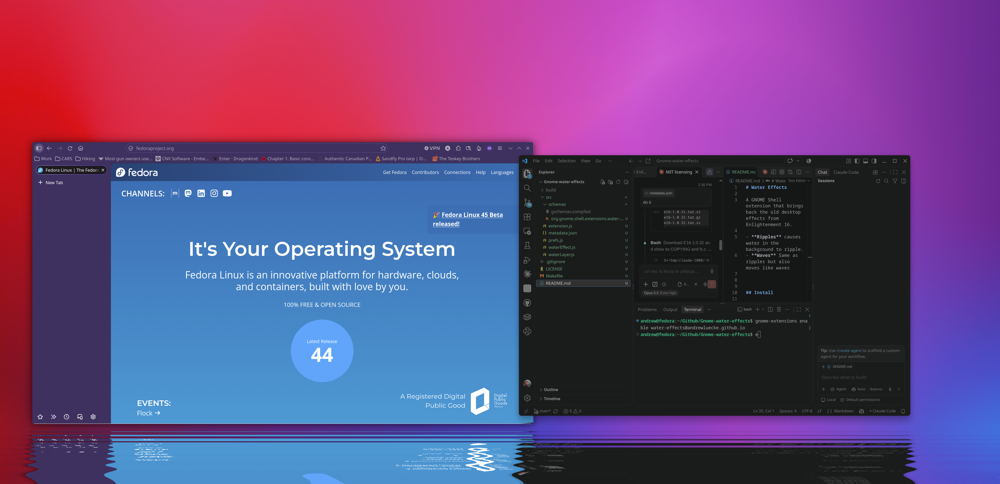

# Water Effects

A GNOME Shell extension that brings back the old desktop effects from Enlightenment 16.

- **Ripples** causes water in the background to ripple. 
- **Waves** Same as ripples but also moves like waves



## Install

```sh
make install
```

You may need to log out and back in. Then:

```sh
gnome-extensions enable water-effects@andrewluecke.github.io
gnome-extensions prefs water-effects@andrewluecke.github.io
```

`make uninstall` removes it.

## Settings

| Setting | Default | Notes |
|---|---|---|
| Effect | Ripples | Ripples or Waves |
| Depth | 64 px | E16 used 64 px; the ripples scale with the depth |
| Strength | 1.0 | 1 matches E16 |
| Speed | 1.0 | 1 matches E16 |
| Stay Above Panels | on | Puts the water above bottom panels and docks, such as Dash to Panel |
| Frame Rate | 30 fps | Lower rates use less power |


## License

MIT. See [LICENSE](LICENSE).

The water effect is derived from `fx.c` in [Enlightenment 16](https://www.enlightenment.org/e16), by Carsten Haitzler, Geoff Harrison, Kim Woelders and contributors. Its licence notice is included in [LICENSE](LICENSE).
